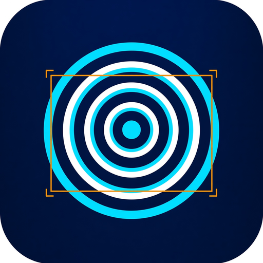
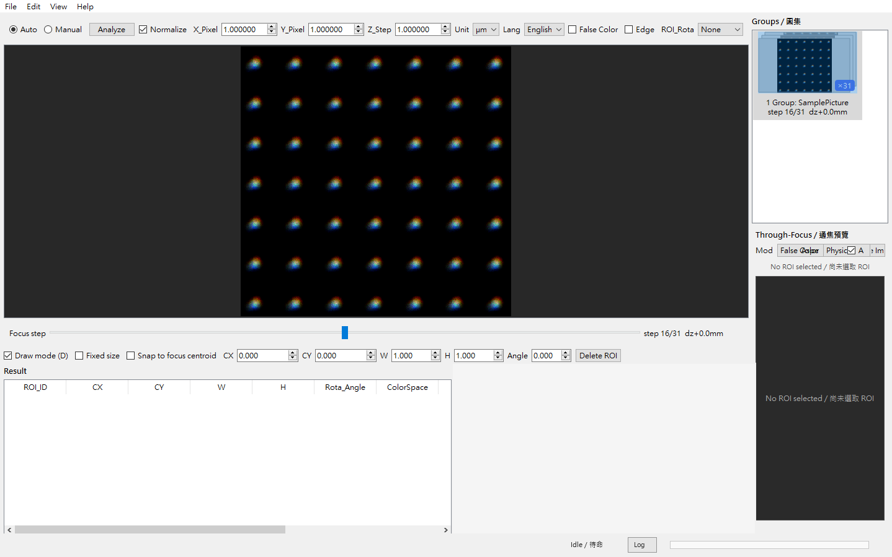
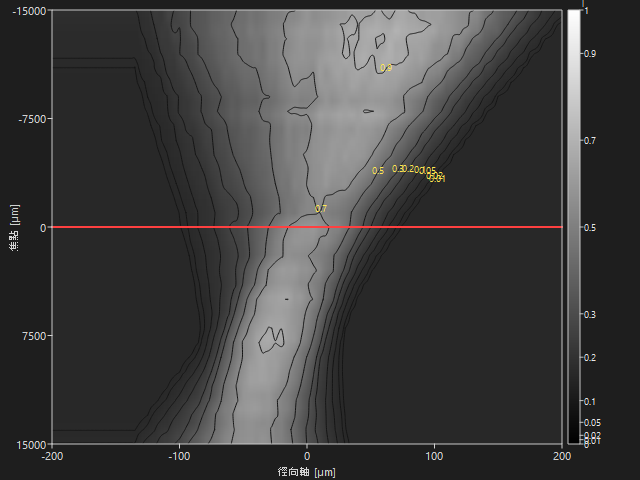

<div align="center">
    
</div>

# ThroughFocus_Viewer

ThroughFocus_Viewer is a through-focus image **ROI viewer** for display and measurement. It opens focus stacks (PNG / BMP / TIFF / JPEG), draws and manages ROIs, builds Focus×Radial through-focus previews (Contour / False Color), and exports Result / ROI / TF workbooks to Excel. It is intentionally **algorithm-free**: no wavefront reconstruction.

ThroughFocus_Viewer helps optical engineers and metrology workflows inspect through-focus stacks quickly — on a Python source install or as a Windows standalone EXE.

<p align="center">
    
    
    
    
</p>

## News

- **11/11/2026**: **v2.0.0** — major line for algorithm-verification prep (`verify_algorithms.py` / full-res `99_Python/VIewer` archive). Viewer remains algorithm-free.
- **11/10/2026**: **v1.1.8** — scale row: Wavenumber then Unit then NA.
- **11/10/2026**: **v1.1.7** — ThroughFocus_Viewer release package (Log-closed screenshot; no home-dir paths in UI Log/Process).

## Why ThroughFocus_Viewer

Full wavefront-retrieval toolchains mix viewing with reconstruction algorithms. ThroughFocus_Viewer is built only for **seeing and measuring** the stack: ROI geometry, through-focus contours, and Excel hand-off — without pulling wavefront solvers into the GUI.

|                        | ThroughFocus_Viewer              | Full retrieval stack              |
| ---------------------- | -------------------------------- | ------------------------------- |
| **Purpose**            | Display + ROI + TF preview       | Reconstruct wavefront / coefficients |
| **Algorithms**         | None                             | Linear / GA / DL / etc.         |
| **Excel**              | Result / ROI / TF (+ Defocus 2D) | Depends on pipeline             |
| **Install**            | Source **or** Win64 EXE          | Usually Python + heavy deps     |
| **Scope boundary**     | Explicitly out of scope          | In scope                        |

## Features

#### 1. Through-focus stack viewing

Open a folder or files as one **Group**. Step Focus with the slider; set **X_Pixel / Y_Pixel / Z_Step / Wavenumber / Unit / NA**; False Color / Edge on the main image.

<div align="center">
    
</div>

#### 2. ROI draw, snap, and settings

Draw ROIs; Fixed size; Snap to focus centroid; ROI_Rota (向心 / 統一旋轉 / None); Save / Load ROI Settings CSV (never overwrite on save).

#### 3. Through-focus Contour / False Color

Auto or Analyze; Normalize; Aspect; Axes; Focus-step marker. Radial from ROI profile × pixel scale; Focus from filename `dz` or `Z_Step`.

<div align="center">
    
</div>

#### 4. Excel export

Export Result, ROI line profiles, and TF matrices (optional Defocus 2D patches). Single workbook or split files. Streamed write to limit peak RAM; progress + Log without UI stutter.

#### 5. Win64 standalone

No Python required: run `ThroughFocus_Viewer_Win64/ThroughFocus_Viewer.exe` (or the companion `.bat`). App icon embedded via PyInstaller.

## Installation

### A) No Python (Windows)

```
Release/ThroughFocus_Viewer_Win64/ThroughFocus_Viewer.exe
```

Or `run_ThroughFocus_Viewer.bat` next to the EXE. Demo stack: `SamplePicture/` (31 frames) when present.

If a clean PC reports missing DLL errors, install **Microsoft Visual C++ Redistributable (x64)**.

### B) Source (Python 3.10+, recommended 3.12)

```bat
cd ThroughFocus_Viewer
setup_env.bat
run_throughfocus_viewer.bat
```

```bash
cd ThroughFocus_Viewer
bash setup_env.sh
./run_throughfocus_viewer.sh
```

- **Windows env:** `%USERPROFILE%\.conda\ThroughFocusViewer` (avoids long-path PySide6 install under Documents)
- **Linux / macOS:** project-local `.conda/ThroughFocusViewer`
- Runtime deps: PySide6-Essentials, numpy, Pillow, openpyxl, matplotlib, opencv-python-headless, scipy

## Quick usage

```bat
run_throughfocus_viewer.bat [image|folder|*.bmp ...]
```

No args → opens `SamplePicture/` or `Sample/` when present.

| Shortcut | Action |
| -------- | ------ |
| `Ctrl+O` | Open image(s) |
| `Ctrl+Shift+O` | Open folder |
| `Ctrl+E` | Export Excel |
| `Ctrl+S` / `Ctrl+Shift+S` | Save / Load ROI Settings |
| `Ctrl+L` | Log |
| `F` / `D` | Fit / Draw |
| `[` `]` | Focus step |
| `F1` | Help |

## Package layout

```
Release/
  README.md                      ← this file
  ReleaseCheckTable.md           ← release verification
  ThroughFocus_Viewer/           ← source package (needs Python)
  ThroughFocus_Viewer_Win64/     ← standalone EXE (no Python)
```

## Out of scope

Wavefront reconstruction (linear / genetic / deep-learning) and related solver pipelines are **not** part of this viewer.

## Check

```bat
set PYTHONPATH=src
python tools\smoke_import.py
python tools\check_tf_viewer_help.py --code
```

See [ReleaseCheckTable.md](ReleaseCheckTable.md) for the signed-off checklist (current ship: **v2.0.0**).
